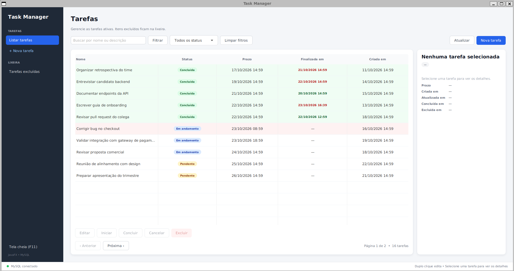

# Task Manager

**Do domínio ao desktop:** um gerenciador de tarefas em Java 25 com arquitetura em camadas, MySQL e interface JavaFX.



*Lista com busca, filtro por status, paginação, status coloridos e painel de detalhes.*

## Contexto e autoria

O objetivo deste projeto foi construir uma aplicação completa — domínio, persistência, testes e interface desktop — e exercitar decisões de engenharia de ponta a ponta.

Conduzi o desenvolvimento com **SDD (Spec-Driven Development)**: defini o problema, os contratos e os critérios de aceite antes de implementar; avancei por camadas, com testes como critério de conclusão.

A IA foi usada como apoio em três frentes: **interface JavaFX** (telas, componentes e CSS), **testes** (unitários e de integração) e **CI/CD** (GitHub Actions). As decisões de arquitetura, modelagem do domínio, regras de negócio, persistência, priorização e revisão do código foram minhas.

**Meu papel:** escopo e critérios de aceite, arquitetura e modelagem, escolha da stack, especificação dos contratos, priorização, revisão e validação.

O uso de IA foi deliberado e documentado. O diferencial aqui não é o volume de código, e sim a direção técnica: especificar, decompor, validar e integrar cada entrega.

## Processo de desenvolvimento (SDD)

1. **Especificação** — problema, escopo e critérios de aceite por camada.
2. **Contratos primeiro** — entidade e invariantes, porta de repositório, DTOs e casos de uso.
3. **Implementação incremental** — domínio → aplicação → infraestrutura → apresentação, com commits pequenos.
4. **Testes como gate** — unitários e integração com MySQL real antes de avançar.
5. **Revisão** — cada entrega foi lida, ajustada e validada contra a especificação.

## Destaques de engenharia

- **Arquitetura em camadas** com a direção das dependências apontando para o domínio.
- **Domínio rico**: `Task` concentra invariantes, transições de status e soft delete, em vez de ser um saco de getters/setters.
- **Portas e adaptadores**: a aplicação define `TaskRepository`; o MySQL implementa o contrato sem vazar detalhes para o domínio.
- **Filtros e paginação server-side**, com ordenação estável e `LIKE` escapado.
- **Persistência real** com MySQL, HikariCP, `PreparedStatement`, upsert e migrations versionadas.
- **Testes em camadas**: unitários com JUnit 5/Mockito e integração com **Testcontainers** em MySQL real.
- **UI JavaFX** com chamadas assíncronas, validação, tratamento de erros por camada e datas no formato `dd/MM/yyyy`.
- Cuidados com **UTF-8/utf8mb4**, timezone, soft delete e dados de demonstração.
- **150 testes** passando, com JaCoCo configurado.

## Funcionalidades

- Criar, listar, visualizar, editar e excluir tarefas (soft delete).
- Restaurar tarefas da lixeira.
- Transições de status: `Pendente`, `Em andamento`, `Concluída` e `Cancelada`.
- Ações rápidas de iniciar, concluir e cancelar.
- Busca por nome ou descrição, filtro por status e botão **Filtrar**.
- Paginação server-side com 10 tarefas por página e navegação anterior/próxima.
- Painel de detalhes com datas de criação, atualização, conclusão e exclusão.
- Linhas coloridas por conclusão/atraso e data de finalização em verde ou vermelho conforme o prazo.
- Formulário em tela cheia, validação inline e calendário em português.
- Janela maximizada, com `F11` para tela cheia e `Esc` para sair.
- Script de seed com tarefas de demonstração.

## Stack

| Área | Tecnologia |
|---|---|
| Linguagem | Java 25 |
| Interface | JavaFX 25.0.5 |
| Build | Maven Wrapper |
| Banco | MySQL 8.4 |
| Pool de conexões | HikariCP |
| Configuração | dotenv-java |
| Testes | JUnit 5, Mockito, Testcontainers |
| Cobertura | JaCoCo |
| Infra local | Docker Compose |
| CI | GitHub Actions |

## Arquitetura

```text
┌──────────────────┐        ┌──────────────────┐
│   presentation   │        │  infrastructure  │
│  JavaFX, views,  │        │ MySQL, HikariCP, │
│  controllers     │        │ repositório      │
└────────┬─────────┘        └────────┬─────────┘
         │                           │
         └─────────────┬─────────────┘
                       ▼
              ┌──────────────────┐
              │   application    │
              │ use cases, DTOs, │
              │ porta repository │
              └────────┬─────────┘
                       ▼
              ┌──────────────────┐
              │      domain      │
              │ Task, status,    │
              │ invariantes      │
              └──────────────────┘
```

`presentation` e `infrastructure` dependem de `application`; `application` depende apenas de `domain`. O domínio não conhece JavaFX, JDBC, MySQL nem variáveis de ambiente.

## Decisões de projeto

**Portas e adaptadores em vez de framework.** A aplicação define o contrato `TaskRepository`; a infraestrutura fornece a implementação MySQL. Isso mantém os use cases testáveis com Mockito e permite trocar a persistência sem tocar nas regras.

**Domínio rico.** As invariantes ficam na entidade: prazo não pode ser anterior à criação, `finishedAt` só existe quando a tarefa está concluída, tarefa excluída não pode ser alterada, transições preservam timestamps. A UI não é o lugar dessas regras.

**Paginação no banco.** Busca, status e paginação são resolvidos em SQL com `COUNT(*)` e `LIMIT/OFFSET`. A UI não carrega a tabela inteira em memória. A ordenação é `deadline, uuid` para ser estável entre páginas.

**Testcontainers em vez de mock de SQL.** Os testes de repositório executam MySQL 8.4 real, cobrindo upsert, filtros, ordenação, paginação, `LIKE` e charset.

**Java puro, sem Spring.** A escolha foi deliberada para aprender os fundamentos: injeção manual por construtor, composição explícita, ciclo de vida e testabilidade. Frameworks virão depois, com critério.

**Trade-offs assumidos.** Não há DI container, Flyway/Liquibase, API REST, autenticação ou observabilidade ainda. A paginação é por offset, adequada ao volume atual; para grandes bases, o próximo passo seria keyset pagination.

## Como executar

### Requisitos

- JDK 25
- Docker e Docker Compose

### Configuração

```bash
cp .env.example .env
docker compose up -d
```

Em um volume novo, o MySQL aplica automaticamente as migrations `V1` (tabela) e `V2` (índices) de `src/main/resources/db/migration`. Se o volume já existir, aplique a `V2` manualmente.

### Interface

```bash
./mvnw javafx:run
```

A aplicação abre maximizada. Use `F11` para alternar a tela cheia e `Esc` para sair dela.

## Dados de demonstração

O script abaixo **limpa a tabela atual** e insere tarefas de exemplo:

```bash
set -a; . ./.env; set +a
docker exec -i taskmanager-mysql mysql --default-character-set=utf8mb4 \
  -u"$DB_USER" -p"$DB_PASSWORD" "$DB_NAME" < scripts/seed-demo.sql
```

O seed inclui tarefas pendentes, em andamento, concluídas no prazo, concluídas com atraso, canceladas e itens na lixeira.

## Testes

```bash
./mvnw clean test
```

- **150 testes**: unitários de domínio, use cases, view models e integração de repositório.
- Os testes de integração usam **Testcontainers**, portanto exigem Docker em execução.
- Os relatórios ficam em `target/surefire-reports/`.

## CI

Workflows em `.github/workflows/`:

- **Tests** — executa `./mvnw -B clean test` em push/PR para `main`/`master` e publica os relatórios.
- **Build** — executa `./mvnw -B -DskipTests clean package` e publica o jar como artefato.

Ambos usam JDK 25 (Temurin), cache do Maven e cancelam execuções antigas do mesmo branch.

## Estrutura do repositório

```text
src/main/java/br/com/taskmanager/
  domain/          entidade Task, enums e exceções de domínio
  application/     use cases, DTOs, consultas paginadas e porta TaskRepository
  infrastructure/  MySQL, HikariCP, factory de DataSource e migrations
  presentation/    JavaFX: shell, telas, controllers, view models e componentes
src/main/resources/
  css/             estilos da interface
  db/migration/    V1 (tabela) e V2 (índices)
src/test/java/     testes unitários e de integração
scripts/           seed de demonstração
.github/workflows/ CI de testes e build
```

## Próximos passos

- Flyway ou Liquibase para versionamento de schema.
- Composition root/DI explícito para reduzir a montagem manual.
- API REST com autenticação, reaproveitando os use cases.
- Paginação por keyset para bases maiores.
- Observabilidade: logs estruturados, métricas e health checks.
- TestFX para testes de interface.
- Empacotamento com `jpackage`/`jlink` para distribuição desktop.

---

Projeto de portfólio em evolução, feito para demonstrar fundamentos de engenharia, consistência arquitetural e capacidade de entregar uma aplicação completa, com apoio de IA na interface, nos testes e no CI/CD.
